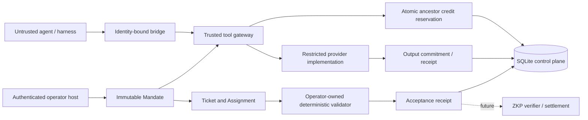

# Architecture

## Boundary and data flow

Only the host issues/revokes mandates, assigns work, registers tools and validators, and administers storage. Agent-visible bridges bind identity server-side. SDK objects share a process in the demo; deployment isolation is a separate requirement.

## Domain mapping

Mandate = immutable authority with provenance principal and policy version. Ticket = durable deliverable with pinned validator registry key. Assignment = bounded agent execution lease for submission. ToolCall = idempotent request with independent status. Receipt = ordered evidence event. Root issuance is trusted administration; delegation must retain principal/policy, narrow tool permissions, respect parent expiry, budgets and depth. IDs cannot be reused because primary keys reject replacement.

Mandate tool execution and assignment submission are currently independent. A ticket is not required for tool use. No context ingestion can mutate authority. Expanding scope requires a fresh mandate; the trusted operator must explicitly authorize it.

## Atomicity and cost accounting

`BEGIN IMMEDIATE` obtains SQLite's write lock before checking limits. Every call reserves its fixed charge against leaf and all ancestors in one transaction, alongside the UNKNOWN execution row and reservation receipt. Siblings share the parent's hard aggregate ceiling. Unused child capacity is not escrowed. Credit accounting is monotonic in this MVP; failed and uncertain calls retain charges.

The transaction commits before provider I/O. Success stores canonical output and a commitment in a second transaction. A failure or process death leaves UNKNOWN; same-key replay refuses re-execution. This is at-most-one attempted invocation per retained key, not exactly-once external delivery. Losing/restoring the database can invalidate this protection. Completed requests replay only while authority is still valid. Keys are globally unique within a database and bound to mandate, identity, tool and argument commitments; use opaque UUIDs.

The registry is trusted process configuration. Changing a tool version or price during in-flight execution requires operator coordination. Current reservations capture the version/cost used; replay returns stored output without rerunning a changed tool.

## Evidence and validation

JSON is serialized with sorted keys, compact separators and nonfinite floats rejected. This is a Python-local convention, **not RFC 8785** or a cross-language cryptographic standard. Receipt hashes commit to previous hash and serialized event. Raw tool inputs are not logged; output JSON and artifacts are stored in the local database. Hash commitments may still leak information about low-entropy secrets.

Submission snapshots an artifact, checks identity/lease/mandate, invokes an operator-owned validator and atomically persists ACCEPTED or REJECTED with artifact hash and validator key. Validators must be pure, bounded, deterministic and immutable by version. They execute under the DB lock in this small implementation; large/untrusted validation must move to an isolated worker with a claim/compare-and-swap completion protocol. Registry absence or exception rolls back acceptance. There is no public method to accept without validation. An operator with database access remains trusted.

## Lifecycle

Ticket: CREATED → RUNNING → ACCEPTED | REJECTED. Assignment creation moves CREATED to RUNNING. Submission is terminal and repeated submission is refused. ToolCall: absent → UNKNOWN → COMPLETED; exceptions and crashes stay UNKNOWN. Mandates: active until revoked or expired; ancestor checks happen on each admission and submission. Cancellation, disputes, reassignment, human approval and settlement states are future work, not hidden implemented states.

## PostgreSQL and DuckDB plan

PostgreSQL is the intended shared transactional authority. Add explicit schema migrations, BIGINT credits with overflow bounds, foreign keys, tenant keys, isolation tests and row-level access controls. Lock the full lineage in globally consistent ID order using `SELECT ... FOR UPDATE`; recheck authority and spend while locked. Use unique idempotency keys and a transactional outbox. Retry serialization failures without rerunning external I/O. Multi-process fault tests must precede replacing SQLite. Do not translate SQLite locking semantics mechanically.

DuckDB is intended for read-only receipt analytics, never authorization or live spending. Export versioned, sanitized snapshots with manifest hash and source checkpoint. Analyze cost per accepted ticket, denial rate and validator failures. Resolve event-to-ticket correlation first: MVP calls reference mandates, not tickets. DuckDB queries must not influence authoritative budget balances. Neither database adapter is shipped yet.

## Production gaps

Authenticated HTTP/MCP service, tenant isolation, scoped human approvals, asynchronous validation, provider reconciliation, signed checkpoints, key management, schema migration management, database backup/restore fencing, telemetry, artifact object storage and framework-native end-to-end testing remain release gates. There is deliberately no HTTP server that might suggest unauthenticated operator methods are deployable.
