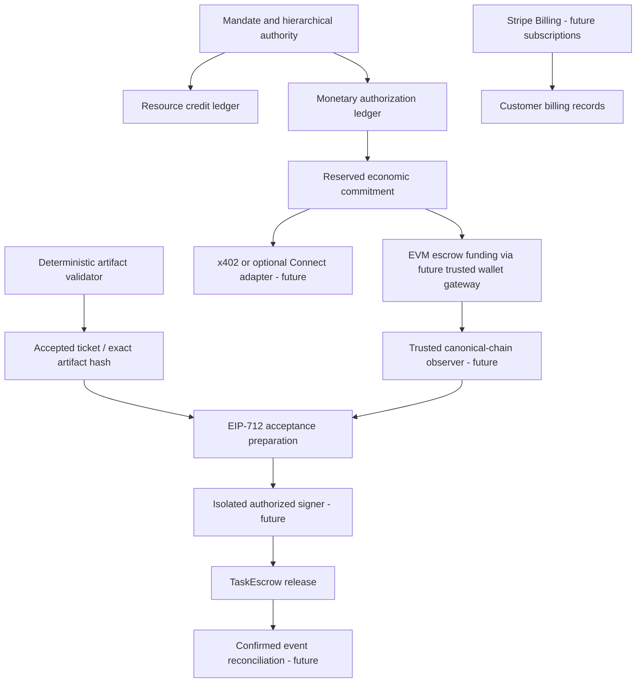

# Blockchain-native settlement prototype

## Status

Solidity source, Foundry tests, a guarded deployment script, Python monetary authorization and EIP-712 typed-data preparation are included. **Foundry/solc are unavailable in this environment, so contract compilation and execution are unverified. No deployment, transaction, stablecoin transfer or Stripe payment was made.** The Python suite tests local authorization and typed-data structure, not an EVM execution or cross-language hash-vector comparison. CI contains a dedicated Solidity job.

This supersedes the earlier Stripe-first framing. Stripe is selected for customer billing/subscriptions; smart-contract settlement is a separate first-class capability. The existing Stripe PaymentIntent sample is not a subscription implementation. See ADR 0006 for exact status by rail.

## Architecture



Monetary authorization limits do not imply wallet funding or solvency. No external payment is marked confirmed by the economic ledger today. There is no automatic bridge from a Stripe charge to resource credits or escrow balance.

## Contracts

`TaskEscrow` holds a single constructor-configured ERC-20. A payer approves the token and calls `fund` with immutable payee, EOA validator, exact base-unit amount, expiry, mandate hash and validator/version hash. The on-chain task ID is keccak256 of the payer and that payer's monotonic nonce. It is distinct from the off-chain reservation ID; bind it using a verified Funded event, not a predicted ID or untrusted tool response.

For release, the validator signs an EIP-712 Acceptance binding task ID, mandate hash, artifact hash, validator hash and deadline. The domain binds chain ID and escrow address. Anyone may relay it, but the recipient and amount cannot change. Release is allowed before task expiry and through the signature deadline; refund is available to the payer at or after expiry. State changes prevent double release/refund. Low-s and v checks reject malleable/invalid signatures.

This is **trusted-validator settlement**. The validator signature establishes what the key attested, not the truth of real-world measurements. EIP-1271 contract-wallet validators, ZKP verification, disputes, partial settlement, emergency pause, admin key rotation and upgradeability are not implemented. Never label it audited or production-ready.

`TestUSD` is a public-mint six-decimal toy ERC-20 with no value or peg. It is not USDC or a real stablecoin. The contract supports standard non-rebasing/non-fee tokens only; malicious, fee-on-transfer, rebase and freezing token behavior require a separate token/security review. Unknown outbound token behavior is not fully verified merely by checking transfer return values.

## Local contract checks

Install Foundry from its official distribution and select the pinned compiler through the project config. No forge-std or other Solidity package is required.

```sh
cd contracts
forge build --sizes
forge test -vvv
```

Authored tests cover release/replay, wrong signer, altered artifact, cross-task/chain/contract replay, malformed/high-s signatures, signature expiry, refund authorization/boundary/double refund and fuzzed token conservation. They have not been executed in this environment. Reentrancy callback tokens, fee/false-return tokens, invariant state machines and an independent audit are additional security gates.

## Base Sepolia dry run and deployment

The script rejects chains other than Base Sepolia (84532) and local Anvil (31337). No mainnet script exists. Use an isolated test wallet with test ETH and no real assets. Keep its key in a Foundry keystore or external signer, never source, chat or command arguments.

```sh
cd contracts
forge script script/Deploy.s.sol:Deploy --rpc-url https://sepolia.base.org --account contractguard-test
```

Without `--broadcast` this simulates. Only after tests/security review and deliberate test-wallet authorization add `--broadcast`. The script deploys a fresh toy token and escrow, not a known stablecoin or pre-funded task. Record the emitted addresses, deployment transaction, chain ID, compiler settings and code hashes. Review the generated `broadcast/` output locally; it is ignored in Git. No such manifest is shipped because nothing has been deployed.

The next integration must provide an authenticated wallet gateway and canonical-chain observer. They must verify chain ID, escrow/token code and addresses, payee/amount/expiry/validator, mandate and version commitments, transaction status and log identity. Choose and test a confirmation/reorg policy; transaction submission is not final settlement. A signer must read these funded terms independently and check that its key matches the pinned validator address before signing typed data. The current Python coordinator does not provide this observer, signer or RPC adapter.

## Economic API

All monetary operations use the already authenticated tenant boundary:

| Route | Role | Purpose |
|---|---|---|
| `/v1/economic/budgets` | operator | Allocate immutable mandate/rail/asset limits and payee allowlist |
| `/v1/economic/commitments` | bound agent | Reserve exact units against every ancestor under an active assignment |
| `/v1/economic/acceptance` | operator | Prepare EIP-712 data from an accepted artifact and independently verified escrow binding |

An asset identifier is exact, for example `eip155:84532/erc20:0x...`. Amounts are integer base units. Child budgets must attenuate parent payees and limits. Limits apply separately per rail/asset; there is no currency conversion, pooled wallet balance or monetary settlement/refund accounting. Reservations are monotonic until a future audited reconciliation flow. Cancellation must not automatically free a reservation that might already have funded an external escrow.

## Standards and future adapters

- [EIP-712](https://eips.ethereum.org/EIPS/eip-712): typed attestations; task state and nonce IDs supply replay prevention.
- [ERC-8004](https://eips.ethereum.org/EIPS/eip-8004): identity/reputation integration remains a future adapter. Registry ownership or reputation never grants spend authority.
- [x402](https://docs.cdp.coinbase.com/x402/welcome): future buyer gateway must bind exact resource, quote, chain/token, amount, payee and expiry before signing. A 402 response is not authorization.
- [Base network documentation](https://docs.base.org/base-chain/quickstart/connecting-to-base): verify network parameters before use.
- [Solidity security considerations](https://docs.soliditylang.org/en/latest/security-considerations.html): review token interaction, reentrancy and external-call behavior before deployment.

ZKP needs a specific circuit and public-input binding to the same task/artifact/version commitments. No mock proof verifier is installed in escrow, and no proof-based release path is advertised as working.
